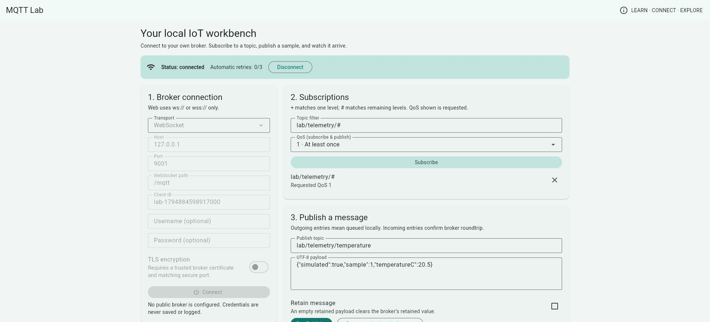

# MQTT Lab · Flutter

[](https://flutter.dev/)
[](https://dart.dev/)
[](https://docs.oasis-open.org/mqtt/mqtt/v3.1.1/os/mqtt-v3.1.1-os.html)
[](https://github.com/kleberandrade/mqtt_aulas_flutter/actions/workflows/ci.yml)
[](LICENSE)

A local-first MQTT learning app for **Android and Web**, based on Kleber Andrade's original IoT lesson repository. Connect to your own broker, explore topic filters, and publish explicitly simulated telemetry. No broker is contacted until you choose **Connect**; no public broker is configured.



## What works

- Configurable host, port, client ID, optional credentials, TCP/WebSocket and TLS.
- Visible disconnected, connecting, connected, reconnecting and failed states.
- A total budget of three automatic retries per manual connection, delayed by 1, 2 and 4 seconds. Successful retries do not replenish this budget. Disconnect cancels it; Connect/Reconnect starts a new session.
- Subscribe and unsubscribe with broker acknowledgments; automatic restoration of confirmed subscriptions after a transport loss. To change a subscription's QoS, unsubscribe first.
- Publish and receive UTF-8 text at QoS 0, 1 or 2, with optional retain. Subscription QoS is the requested maximum; brokers can grant a lower level.
- A newest-first history capped at 100 entries. Outgoing **QUEUED** means handed to the client, not delivered. Incoming **RECEIVED** confirms receipt on a subscription. QoS 2 is a protocol guarantee, not an application-level exactly-once side-effect guarantee.
- Simulated temperature sample generation, labeled `"simulated": true`. Generation fills the editor; **Publish** sends it.

## Quick start

Use Flutter **3.41.9** (Dart **3.11.5**), Docker with Compose v2, and Chrome. For Android, install the Android SDK/JDK required by Flutter and complete the SDK's license setup yourself.

```sh
git clone https://github.com/kleberandrade/mqtt_aulas_flutter.git
cd mqtt_aulas_flutter
flutter pub get --enforce-lockfile
docker compose up -d --wait
flutter run -d chrome
```

In the Web app, use host `127.0.0.1`, port `9001`, **WebSocket**, path `/mqtt`, TLS **off**. Leave credentials empty for the included development broker. Click **Connect**, subscribe to `lab/telemetry/#`, then **Publish** the sample on `lab/telemetry/temperature`:

```json
{"simulated":true,"temperatureC":23.5}
```

Both QUEUED and RECEIVED should appear. Topic names are case-sensitive. `+` matches exactly one level; `#` matches remaining levels and must be last. Publish topics cannot contain wildcards. Wildcard filters starting with `#` or `+` do not match the broker's `$SYS` tree; subscribe to `$SYS/#` explicitly if needed.

### Android

```sh
flutter devices
flutter run -d <android-device-id>
flutter build apk --debug
```

The Android emulator defaults to `10.0.2.2:1883`, **TCP**, TLS off. `10.0.2.2` reaches the development computer. The Compose broker exposes ports on computer loopback only. For a physical USB device, use port forwarding instead of opening an anonymous broker on the LAN:

```sh
adb reverse tcp:1883 tcp:1883
adb reverse tcp:9001 tcp:9001
```

Then enter `127.0.0.1` in the app. Physical-device behavior has not been validated here. Android networking permissions are included in the main manifest. Debug APK: `build/app/outputs/flutter-apk/app-debug.apk`. The template's release signing remains a development placeholder; configure your own private keystore before distributing an Android release.

### Independent simulated publisher

With the local broker running, subscribe in the app, then:

```sh
dart run tool/telemetry.dart
```

This finite, loopback-only example publishes five JSON temperature samples, confirms each roundtrip, unsubscribes and closes the socket. It never represents a physical sensor. You can also publish independently of Dart:

```sh
docker compose exec -T broker mosquitto_pub -h 127.0.0.1 -t lab/telemetry/temperature -q 1 -m '{"simulated":true,"temperatureC":24.0}'
```

Stop this project's broker with `docker compose down`. Persistence is disabled; retained state disappears when the broker restarts.

## Transports and TLS

Android supports TCP and WebSocket. A browser **cannot open a raw TCP MQTT connection**: Web requires `ws` or `wss` and a broker WebSocket listener. The included broker provides unencrypted MQTT on `1883` and WebSocket on `9001`; it provides **no TLS listener**. Changing only the TLS toggle will therefore fail.

For a secure broker, enable TLS and enter that broker's secure port (commonly `8883` for TCP; WebSocket ports vary). The host must match a certificate trusted by the platform. Native TLS uses the client's default trust context; browsers use browser certificate policy. No certificate-validation bypass, custom CA picker or mutual-TLS client certificate UI is supplied. Browser HTTPS pages generally require `wss`, not `ws`; CSP and broker/proxy origin rules must also permit the connection. See [mqtt_client's supported transports](https://pub.dev/packages/mqtt_client) and [troubleshooting](docs/TROUBLESHOOTING.md).

Credentials remain in memory for the current form and reconnect policy; they are not persisted or logged. Entering credentials with TLS off sends them unencrypted. Use the anonymous, loopback broker only for local exercises. For remote use, provision an authenticated TLS broker with topic ACLs. The app does not provision it.

## Validation and limits

- Hostnames/IP addresses without schemes or paths; ports 1–65535; conservative client IDs (1–64 ASCII letters/digits, `_`, `-`). IDs must be unique per connected client.
- MQTT topic/filter limits: nonempty, valid Unicode, no NUL, at most 65,535 UTF-8 bytes, whole-level wildcards only in subscription filters.
- Outgoing payloads: arbitrary UTF-8 text, including empty strings, capped at 65,536 bytes as an application limit. Incoming binary payloads display replacement characters; previews over 64 KiB are truncated after receipt. The underlying library still receives the full packet; this is not a wire-size defense.
- Connection timeout at most 8 seconds per attempt; subscribe/unsubscribe acknowledgments time out after 5 seconds. Errors shown to users omit library exceptions and credentials.
- Clean MQTT sessions; history, credentials and subscriptions are not stored across app restarts. Confirmed subscriptions are restored only during automatic reconnects. No offline publish queue, charts, hardware integration or background-service guarantee is provided.

## Tests and builds

```sh
dart format --output=none --set-exit-if-changed lib test tool
flutter analyze --fatal-infos
flutter test --coverage
docker compose up -d --wait
flutter test --concurrency=1 --dart-define=LOCAL_BROKER=true test/integration
flutter test --platform chrome --dart-define=LOCAL_BROKER=true test/integration/broker_test.dart
dart run tool/telemetry.dart
flutter build web --release
flutter build apk --debug
docker compose down
```

Ordinary tests never contact a broker; integration tests require the explicit flag. Run native integrations serially because one test deliberately restarts **this Compose project's broker** to verify reconnect and resubscription. Do not run that test against a shared broker. The Chrome test validates the real browser WebSocket adapter, not native TCP.

Local validation: analyzer, unit/widget tests, real TCP/WebSocket QoS roundtrips, broker-restart recovery, Chrome WebSocket test, simulated publisher, Web release build and Android debug build. No physical-device, live TLS or app-store validation is claimed. [CI](.github/workflows/ci.yml) pins Flutter, action commits, dependencies and broker image digest; the linked GitHub Actions badge reports the current remote result for `master`. The workflow runs on pushes and pull requests; it does not deploy the app. See [work log](docs/WORK_LOG.md).

## Code map

- `lib/src/mqtt/models.dart`: data shapes and protocol boundaries.
- `transport.dart`: injectable adapter contract; `client_transport.dart`: MQTT library bridge with ACK deadlines and bounded display previews.
- `client_native.dart` / `client_web.dart`: conditional platform socket construction.
- `session.dart`: observable session state, retry budget, subscriptions and bounded history.
- `lib/src/ui/`: Material 3 responsive workbench. Widgets depend on the session, not the MQTT library.
- `test/support/`: in-memory transport double; `test/integration/`: opt-in local broker tests.
- `broker/`, `compose.yaml`, `tool/`: reproducible local exercises.

A **topic** addresses published messages; a **filter** describes subscriptions; **QoS** controls MQTT delivery exchange; **retain** stores the latest value at the broker; **clean session** means the broker does not restore prior subscription state. Application retry policy is independent of MQTT QoS retransmission.

## License and attribution

[MIT](LICENSE), original copyright © 2019 Kléber de Oliveira Andrade, preserved. Flutter-generated platform shells and icons originate from Flutter tooling. [mqtt_client](https://pub.dev/packages/mqtt_client) is an external dependency with its own MIT/BSD notices; Mosquitto is an external Docker image with its own EPL/EDL licensing. This repository's MIT license does not relicense those dependencies. Flutter's built-in LicenseRegistry supplies dependency notices in builds; dependency license texts also remain in their distributions.
